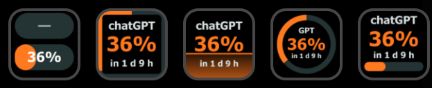
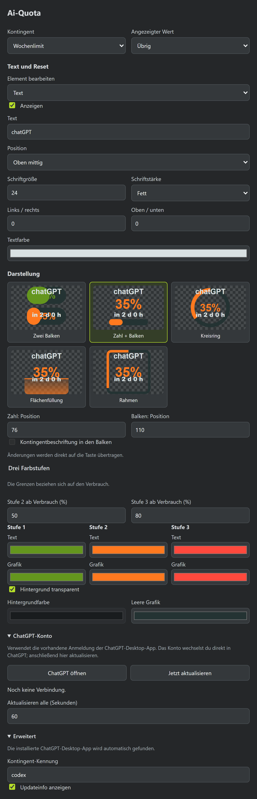

# Ai-Quota

Version **0.0.2.2** · Autor **NAS4Killer**

Ai-Quota zeigt verfügbare ChatGPT-Work-/Codex- und Claude-Kontingente auf
Stream-Deck-Tasten an. Für ChatGPT und Claude gibt es jeweils eine eigene
Aktion mit getrennten Einstellungen pro Taste.



## Funktionen

- 5-Stunden- und Wochenkontingente anzeigen, soweit vom Konto bereitgestellt.
- Zwischen übrigem und verbrauchtem Kontingent wählen.
- Fünf Darstellungen: Zwei Balken, Zahl + Balken, Kreisring, Flächenfüllung und Rahmen.
- Drei Verbrauchs-Farbstufen mit einstellbaren Grenzen und getrennten Text- und Balkenfarben.
- Transparenter Hintergrund, anpassbarer Titel und optionale Resetanzeigen.
- Text, 5-Stunden-Reset und Wochen-Reset unabhängig positionieren und formatieren.
- Automatische Kontingentaktualisierung und manuelle Aktualisierung per Tastendruck.
- Beim Start die Versionsnummer der auf GitHub committeten Version prüfen.
- Eine neuere Version durch einen roten Punkt auf der Taste kennzeichnen.
- Bei sichtbarem roten Punkt öffnet ein Tastendruck die GitHub-Seite des Plugins.
- Updateinfo ganz unten in den Einstellungen pro Taste ein- oder ausschalten.

## Voraussetzungen und Anmeldung

Windows 10 oder neuer und Stream Deck 7.1 oder neuer.

**ChatGPT:** Das Plugin nutzt die vorhandene Anmeldung der installierten
ChatGPT-Desktop-Laufzeit. Es werden die gemeinsamen Work-/Codex-Kontingente
abgefragt. Das sind nicht sämtliche Nachrichtenlimits der normalen ChatGPT-Chats.

**Claude:** Das Plugin verwendet die Claude-Code-Anmeldung. Für den regulären
Claude-Code-Zugang ist ein dafür freigeschaltetes Abo erforderlich. Die alleinige
Anmeldung in Claude Desktop wird nicht übernommen. Ein bereits vorhandenes
Claude-Code-Programm wird gesucht; zusätzlich ist eine Windows-x64-Laufzeit
im Installationspaket enthalten. Die Anmeldung lässt sich in den Kontoeinstellungen
der Claude-Aktion starten.

Anmeldungen bleiben unter der Verwaltung der jeweiligen Laufzeit. Das Plugin
kopiert keine privaten Anmelde- oder Kontodateien in seine Einstellungen.

## Installation und Bedienung

Das Paket [`de.ai-quota.streamDeckPlugin`](Release/de.ai-quota.streamDeckPlugin) öffnen und
die Installation in Stream Deck bestätigen. Anschließend die Aktion **chatGPT**
oder **Claude** auf eine Taste ziehen und die Anzeige nach Wunsch einstellen.

Ohne sichtbaren Updatepunkt aktualisiert ein Tastendruck das Kontingent.
Bei sichtbarem Updatepunkt öffnet er die
[GitHub-Seite](https://github.com/NAS4Killer/Ai-Quota).
Die Updateinfo ist standardmäßig eingeschaltet. Ist sie für sämtliche verwendeten
Tasten ausgeschaltet, startet keine GitHub-Abfrage. Die Prüfung erfolgt einmal
pro Pluginstart; eine erstmalige spätere Aktivierung löst sie ebenfalls aus.

## Aus dem Quellcode bauen

Benötigt werden Node.js ab Version 24 und npm. Im Unterordner `Repository` ausführen:

```powershell
npm ci
npm run build
npm test
npx --no-install streamdeck validate de.ai-quota.sdPlugin
npx --no-install streamdeck pack de.ai-quota.sdPlugin --force --no-update-check --no-file-list
```

Das Ergebnis ist `de.ai-quota.streamDeckPlugin`.
Abhängigkeiten, generierte Laufzeiten und das Installationspaket sind nicht Teil
des Quellcodebestands und werden mit diesen Befehlen erstellt.

## Codeübersicht

| Datei | Aufgabe |
| --- | --- |
| `Repository/src/plugin.js` | Stream-Deck-Protokoll, Aktionen, Einstellungen und Aktualisierung |
| `Repository/src/quota.js` | ChatGPT-Desktop-Anbindung und Kontingentdaten |
| `Repository/src/claude-connection.js`, `Repository/src/claude.js` | Claude-Code-Verbindung, Anmeldung und Kontingentdaten |
| `Repository/src/render.js` | Werkseinstellungen, SVG-Darstellung und Resettexte |
| `Repository/src/update.js` | GitHub-Versionsabfrage und numerischer Versionsvergleich |
| `Repository/src/version.js` | Laufzeitversion |
| `Repository/de.ai-quota.sdPlugin/ui/settings.html` | Einstellungsoberfläche |
| `Repository/de.ai-quota.sdPlugin/manifest.json` | Plugin-Metadaten und Aktionen |
| `Repository/tests/` | Automatisierte Funktionsprüfungen |

Rendereränderungen werden in `Repository/src/render.js` vorgenommen. Der Build aktualisiert
den gekennzeichneten Rendererblock der Einstellungsoberfläche automatisch.
Die GitHub-Prüfung liest ausschließlich die Versionsnummer aus dem Plugin-Manifest
des Standardzweigs und verwendet keine Konto-Zugangsdaten.

## Einstellungsmöglichkeiten


